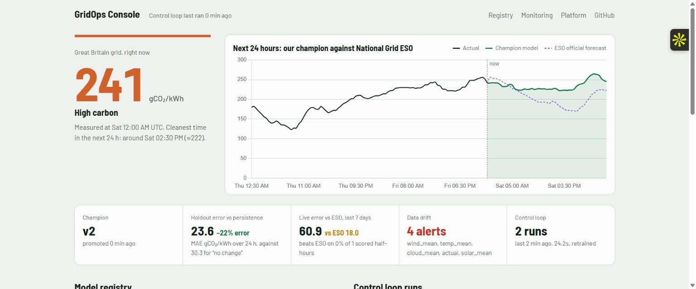
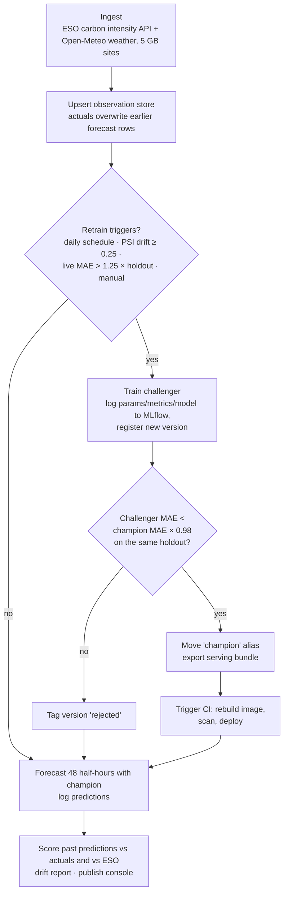

# GridOps: an end-to-end MLOps platform around a live forecasting model

[](https://github.com/PalakGupta7456/mlops-platform/actions/workflows/ci.yml)
[](https://github.com/PalakGupta7456/mlops-platform/actions/workflows/pipeline.yml)
    

**Live console: https://palakgupta7456.github.io/mlops-platform/**

The model here is deliberately simple: LightGBM forecasting Great Britain's grid carbon intensity 24 hours ahead. **The point of this project is everything around it.** That means continuous training on live data, an MLflow model registry with a **champion/challenger promotion gate**, **drift and live-performance monitoring** that trigger retraining, a serving API instrumented for **Prometheus**, and CI/CD that tests, scans, ships and **rolls the model out to Kubernetes**. It also has infrastructure as code for **AWS**, and a **Jenkins** pipeline.

There are two honest yardsticks:
- **Offline**, every version must beat *persistence* ("no change from now") on the same held-out days.
- **Live**, every forecast is logged next to National Grid ESO's official forecast *as it stood at the same moment*, and both are scored when the real value arrives.

## A production lesson this platform caught

The first champion trained on August–October data looked fine on synthetic tests. On the live grid, though, it **lost to persistence** (MAE 59.6 vs 30.3) and forecast a crash every hour. Debugging the real data showed why:

- **Regime shift.** The holdout period averaged 178 gCO₂/kWh against 114 in training (autumn turning to November: more gas, less solar).
- **Level-anchored features.** With absolute features, the trees had learned that "230+ is a rare spike that falls back". In November it isn't rare.
- **Unfair baseline.** ESO's historical "forecast" field is a last-minute nowcast, so comparing a 24-hour-ahead model against it offline wasn't fair.

The fix:
1. **Scale-free features.** Lags, rolling means and weather are all expressed *relative to now*, and the target is the *change* from now.
2. **A validated per-horizon blend with persistence.** The weights are fitted on a separate validation window, so the forecast falls back to persistence where the model has no edge (the next 30 minutes) and trusts the model where it does.
3. **Fair baselines.** Persistence is the offline baseline, and ESO is compared only through the live log.

Result on the same real holdout: **MAE 23.6 vs 30.3, which is 22% better than persistence and better at every horizon from 30 minutes to 24 hours.** A regression test (`test_scale_free_model_survives_a_level_shift`) now locks this in.

Drift monitoring was tuned for the same reason. It compares the last 7 days with the 28 days before them (not with the whole training window, which flags the slow march of the seasons every hour), and drift-triggered retrains have a 6-hour cooldown.



## The control loop (hourly, serverless on GitHub Actions)



## Platform components

| Layer | Implementation |
|---|---|
| **Experiment tracking and registry** | MLflow (SQLite backend plus a file artifact store, persisted on the `live-data` branch). Every run logs params, metrics, feature importance, error by horizon and the model, then registers a version tagged `promoted` or `rejected`. Promotion moves the `champion` alias. |
| **Model** | LightGBM predicts the change from now using scale-free features. A `PersistenceBlend` wrapper applies per-horizon weights fitted on a validation window that is separate from the holdout. It is logged to MLflow as a single model, so the serving code calls one `predict`. |
| **Promotion gate** | The challenger and the current champion are scored on *the same* held-out window. A 2% margin stops the champion flip-flopping on noise. Tests cover promotion, rejection and retention. |
| **Retention** | Keeps the newest 6 versions plus the champion and deletes older artifacts. A regression test caught a real bug here: MLflow 3 returns version numbers as integers, so the champion was not recognised and was pruned. |
| **Monitoring** | Prediction log, then live MAE against ESO on identical half-hours, plus a win rate. Feature drift uses PSI and a KS test against the training window. Alerts feed back into the retrain trigger. |
| **Serving** | FastAPI with `/predict`, `/forecast`, `/model`, `/health`, hot `/reload` and `/metrics`. The image is multi-stage and non-root, with a health check. MLflow is not needed at serve time because the champion is exported as a plain bundle. |
| **Observability** | Prometheus metrics: request rate, latency histograms, errors, prediction distribution and model version. Alert rules (validated in CI with `promtool`). A provisioned Grafana dashboard. |
| **Kubernetes** | Deployment with zero-downtime rolling updates, readiness and liveness probes, a read-only root filesystem, non-root user, HPA (2–8 pods on CPU) and a PodDisruptionBudget. Validated with `kubeconform` and **actually deployed to a kind cluster in CI** on every main build. |
| **Cloud IaC** | Terraform for AWS: ECR with scan-on-push and a lifecycle policy, an IAM role, and App Runner with autoscaling and health checks. S3 remote state. `cd-aws.yml` copies the image from GHCR to ECR and applies, behind a `production` environment approval. |
| **CI** | ruff, pytest, a **model quality gate** (must beat persistence on held-out data), IaC validation, Docker build, **Trivy** image scan, smoke test, push to GHCR, then a kind deploy test. |
| **Jenkins** | The same stages plus a manual `input` approval before production, and an automatic `kubectl rollout undo` if the rollout fails. |

## Run the whole platform locally

```bash
docker compose up --build                       # API :8000 · MLflow :5000 · Prometheus :9090 · Grafana :3000
docker compose run --rm trainer                 # run the control loop against the MLflow server
docker compose --profile load up loadgen        # generate traffic for the Grafana dashboard
```

Without Docker:

```bash
pip install -e ".[train,api,dev]"
python -m gridops.pipeline                      # live data (add --synthetic for offline, --retrain to force)
uvicorn api.main:app --reload
mlflow ui --backend-store-uri sqlite:///state/mlflow.db
pytest
```

## Deploy to Kubernetes / AWS

```bash
kubectl apply -f deploy/k8s/
kubectl -n gridops set image deployment/gridops-api api=ghcr.io/palakgupta7456/gridops:<sha>
```

For AWS, add the `AWS_ACCESS_KEY_ID`, `AWS_SECRET_ACCESS_KEY` and `TF_STATE_BUCKET` repository secrets, then run **CD to AWS App Runner**.

## Repository layout

```
src/gridops/   data · features · registry (MLflow, gate, retention) · monitoring (PSI, live scoring, triggers) · pipeline
api/           FastAPI + Prometheus
deploy/k8s     Deployment, Service, HPA, PDB
deploy/monitoring  Prometheus config + alert rules, Grafana provisioning + dashboard
infra/terraform    AWS ECR + App Runner
.github/workflows  ci.yml · pipeline.yml (hourly loop) · cd-aws.yml
Jenkinsfile · Dockerfile · docker-compose.yml
```
